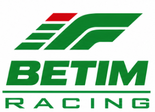
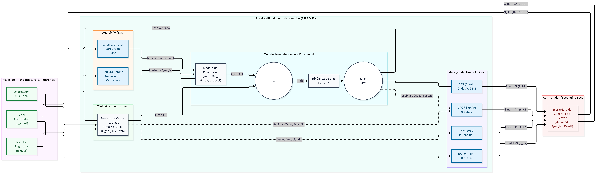
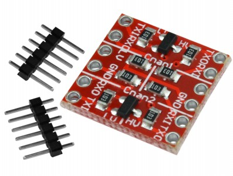

<p align="center">
  
</p>

<h1 align="center">Simulador Dinâmico HIL — Speeduino 48-Way</h1>

<p align="center">
  <b>Bancada Hardware-in-the-Loop orientada ao condutor (Logitech G29 / Sliders Virtuais + ESP32 DevKit V1 + KTM Duke 390)</b><br/>
  <i>Instituto Federal de Minas Gerais (IFMG) — Campus Betim · Equipe IF Betim Racing</i>
</p>

<p align="center">
  
  
  
  
</p>

---

## Visão Geral

Este repositório reúne o firmware embarcado, a interface gráfica de controle/telemetria, a modelagem física parametrizável em JSON e a documentação técnica em LaTeX da **Bancada de Simulação Dinâmica HIL** da equipe **IF Betim Racing**.

O sistema permite validar mapas de injeção/ignição, estratégias de partida, corte de giro e malha fechada da **Speeduino 48-Way** em bancada antes de levar a calibração para a pista, simulando em tempo real a planta completa de uma **KTM Duke 390** (~373 cm³, monocilíndrica, roda fônica **22-2**):

- **Modo Duplo de Pilotagem no PC (`interface_g29.py`):** opere a bancada tanto pilotando um **Logitech G29 real** (volante, pedais e câmbio H / borboletas) quanto pelo **Modo Simulado na Interface (Barrinhas/Sliders de 0% a 100%)**, ideal para cravar pontos estacionários de TPS ou testar sem o volante conectado.
- **Planta Dinâmica em Tempo Real no ESP32 (`HIL_Esp/HIL_Esp.ino`):** integra a cada `0,5 ms` a inércia do virabrequim, curva de torque WOT, atrito interno, marcha lenta, acoplamento progressivo de embreagem, câmbio de 6 marchas (+ ré virtual de bancada), arrasto aerodinâmico, resistência ao rolamento e freios — gerando um sinal **VSS** com decaimento inercial fiel à motocicleta real.
- **Roda Fônica 22-2 via DMA/I2S (`PCM5102A`):** síntese senoidal contínua de 44,1 kHz sem travar o laço principal da física.
- **Parametrização Quente sem Regravar (`moto_duke390.json`):** altere cilindrada, inércia, vazão de bico, massa, relações de marcha ou curva de torque no JSON e envie via Serial com um clique.

---

## Links Importantes (Documentação & Mapa Base)

| Recurso | Acesso |
|---|---|
| **Documentação Técnica Completa (PDF)** | [**`SimulacaoComG29_ComOPCEEsp.pdf`**](./SimulacaoComG29_ComOPCEEsp.pdf) *(fontes LaTeX em [`SimulacaoComG29_ComOPCEEsp/`](./SimulacaoComG29_ComOPCEEsp/))* |
| **Mapa Base Oficial (`.msq`) e Configurações do TunerStudio** | [**Acessar Pasta Oficial no Google Drive**](https://drive.google.com/drive/u/1/folders/1bbK6THQXaumvtmB5yQu2AqLAyRcFz2Z0) |

> **Importante:** O arquivo `.msq` disponível no Google Drive já entrega toda a configuração base da **Speeduino 48-Way** pronta para a bancada (decodificador de roda fônica `22-2`, portas de entrada/saída, calibração inicial de sensores e tabelas base de VE e avanço).

---

## Arquitetura do Sistema HIL

<p align="center">
  
</p>

1. **Interface Humana (PC — Python/Tkinter @ 30 Hz):** lê o Logitech G29 via `pygame` *ou* os sliders manuais de `0%` a `100%`, transmite comandos à razão de `115200 bps` pela porta COM e exibe o painel de telemetria em tempo real (`RPM`, `km/h`, `VSS Hz`, `Torque Nm`, `MAP kPa`, `Pulso de Injeção µs`, `Fator de Combustível` e `Ignição`).
2. **Planta Física (ESP32 DevKit V1 — 30 pinos):** converte as variáveis do modelo em tensões analógicas (`DAC1` e `DAC2` filtrados por RC), frequência variável (`PWM LEDC` para o `VSS`), nível digital (`Clutch_in`) e onda fônica diferencial/AC (`I2S -> PCM5102A`).
3. **Fechamento de Malha (Speeduino $\rightarrow$ Conversor de Nível Lógico $\rightarrow$ ISRs do ESP32):** captura por interrupção de hardware a largura de pulso do bico injetor (`INJ-1-OUT`) e o disparo da centelha (`IGN-1-OUT`).

---

## Mapeamento de Pinos (ESP32 DevKit V1 $\leftrightarrow$ Speeduino 48-Way)

Para preservar os dois conversores analógicos internos de 8 bits do ESP32 (`GPIO 25` e `GPIO 26`) dedicados ao **TPS** e ao **MAP**, os pinos de relógio do módulo **I2S PCM5102A** foram alocados em `GPIO 27` e `GPIO 14`:

| Sinal Simulado / Lido | Pino ESP32 | Tipo de Sinal | Condicionamento / Módulo | Conector Speeduino |
|---|---|---|---|---|
| **TPS** (Acelerador) | `GPIO 25` | `DAC1` (0–3,3 V) | Filtro RC ($10\text{ k}\Omega + 1\,\mu\text{F}$ p/ `GND`) | `B_C7` (`TPS_Sensor`) |
| **MAP** (Pressão Coletor) | `GPIO 26` | `DAC2` (0–3,3 V) | Filtro RC ($10\text{ k}\Omega + 1\,\mu\text{F}$ p/ `GND`) | `B_C8` (`MAP-EXT`) |
| **Crank 22-2** (`BCK`) | `GPIO 27` | `I2S BCK` | Pino `BCK` do PCM5102A | `B_B2` (`CRANK-IN`) |
| **Crank 22-2** (`LCK`) | `GPIO 14` | `I2S WS/LCK` | Pino `LCK` do PCM5102A | *(saída de áudio `L` do PCM5102A)* |
| **Crank 22-2** (`DIN`) | `GPIO 22` | `I2S DATA` | Pino `DIN` do PCM5102A (`SCK` aterrado no `GND`) | `B_B3` (`VR1-` $\leftarrow$ `GND` PCM5102A) |
| **VSS** (Velocidade) | `GPIO 16` | `PWM LEDC` | Direto ($0\text{--}3{,}3\text{ V}$, proporcional a $v$) | `B_A7` (`VSS`) |
| **Embreagem** | `GPIO 15` | Saída Digital | Direto ($0\text{--}3{,}3\text{ V}$) | `B_B7` (`Clutch_in`) |
| **Retorno Bico 1** | `GPIO 4` | `ISR (CHANGE)` | Conversor de Nível Lógico (`Chan2`: `HV` $\rightarrow$ `LV`) | `G_A1` (`INJ-1-OUT`) |
| **Retorno Bobina 1** | `GPIO 5` | `ISR (RISING)` | Conversor de Nível Lógico (`Chan1`: `HV` $\rightarrow$ `LV`) | `G_B1` (`IGN-1-OUT`) |
| **Referência Comum** | `GND` | Terra Lógico | Unificar `GND` do ESP32, PCM5102A, Conversor e ECU | `B_A8` (`GND Sensores`) |

### Condicionamento sem Bico e sem Bobina Físicos (Level Converter)

<p align="center">
  
</p>

Como na bancada HIL **não conectamos bico injetor nem bobina de ignição reais**, não existem cargas indutivas nem surtos de alta tensão (*flyback*). Assim, um **Módulo Conversor de Nível Lógico Bidirecional** (MOSFET BSS138 com resistores de *pull-up* de $10\text{ k}\Omega$ integrados) realiza toda a leitura de retorno com total segurança para o ESP32 ($3{,}3\text{ V}$):

- **Alimentação do módulo:** `HV = 5V`, `LV = 3.3V` (do ESP32) e `GND` comum.
- **Injeção (`G_A1 — INJ-1-OUT` $\rightarrow$ Canal 2 $\rightarrow$ `GPIO 4`):** a saída de injetor da Speeduino é *Low-Side* (dreno aberto). O próprio resistor de *pull-up* de $10\text{ k}\Omega$ do lado `HV` faz o papel de carga virtual segura: mantém `3,3 V` em repouso no `GPIO 4` e cai instantaneamente a `0 V` durante o tempo exato de abertura do bico.
- **Ignição (`G_B1 — IGN-1-OUT` $\rightarrow$ Canal 1 $\rightarrow$ `GPIO 5`):** converte o pulso lógico de `5 V` (*Smart Coil*) da ECU para `3,3 V` limpos na entrada de interrupção do ESP32.

---

## Estrutura de Arquivos

```text
SimulacaoHil/
├── HIL_Esp/
│   └── HIL_Esp.ino                       # Firmware principal do ESP32 DevKit V1 (física + I2S + DAC + ISRs)
├── CodigoEsp/
│   └── CodigoEsp.ino                     # Código base histórico (gerador isolado da roda fônica 22-2)
├── SimulacaoComG29_ComOPCEEsp/
│   ├── SimulacaoComG29_ComOPCEEsp.tex    # Código-fonte LaTeX da documentação técnica
│   └── images/                           # Logos, diagrama HIL e foto do conversor de nível lógico
├── interface_g29.py                      # Interface gráfica Tkinter (Modo G29 Real + Modo Sliders 0-100%)
├── moto_duke390.json                     # Parâmetros físicos documentados da KTM Duke 390
├── config_g29.json                       # Preferências salvas automaticamente pela interface
├── requirements.txt                      # Dependências Python (pygame, pyserial)
└── SimulacaoComG29_ComOPCEEsp.pdf        # Documentação técnica compilada pronta para leitura
```

---

## Como Reproduzir Passo a Passo

### 1. Carregar o Mapa Base na Speeduino
1. Baixe o arquivo `.msq` na [pasta oficial do Google Drive](https://drive.google.com/drive/u/1/folders/1bbK6THQXaumvtmB5yQu2AqLAyRcFz2Z0) e abra no **TunerStudio**.
2. Como os DACs nativos do ESP32 excursionam de `0 V` a `3,3 V`, faça a calibração rápida de **TPS** no TunerStudio (*Tools $\rightarrow$ Calibrate TPS*) usando `0%` e `100%` pela própria interface Python.

### 2. Gravar o ESP32 DevKit V1
1. Abra [`HIL_Esp/HIL_Esp.ino`](./HIL_Esp/HIL_Esp.ino) na **Arduino IDE** (com o pacote *esp32 by Espressif Systems* instalado).
2. Selecione a placa **`ESP32 Dev Module`** e faça o upload via USB.

### 3. Executar a Interface no PC
```powershell
git clone https://github.com/LasCazas/SimulacaoHil.git
cd SimulacaoHil

python -m venv .venv
.\.venv\Scripts\activate
pip install -r requirements.txt

python interface_g29.py
```

### 4. Operar (Com ou Sem Volante G29)
- Selecione a **Porta COM** do ESP32 e clique em **Conectar** (após `2 s`, os parâmetros de `moto_duke390.json` são carregados automaticamente no ESP32).
- Escolha em **Modo de Controle**:
  - **Volante Real (Logitech G29):** lê pedais, volante, câmbio H (1ª a 6ª + Ré) e borboletas. Ajuste os números dos eixos ou `inv` se necessário — tudo fica salvo em `config_g29.json` ao fechar a janela.
  - **Simulado na Interface (Barrinhas % / Manual):** arraste os sliders ou digite a porcentagem exata de `0%` a `100%` (ótimo para estabilizar pontos específicos de carga/RPM durante o acerto do mapa!) e clique nos botões de marcha `R`, `N`, `1..6`.
- Para ativar a realimentação em malha fechada pelo pulso real do bico da Speeduino, mude `"use_inj_feedback"` para `1` em [`moto_duke390.json`](./moto_duke390.json) e clique em **Reenviar parâmetros**.

---

<p align="center">
  
  <br/>
  <sub>Desenvolvido por <b>William Las-Cazas Queiroz</b> — Capitão e Gerente Técnico (Equipe Elétrica · IF Betim Racing)</sub>
</p>
